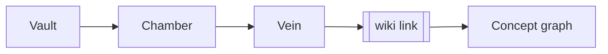

# Macusanite Wiki syntax

This file ships with the application (menu **☰ → Vault Wiki.md**) and is the
reference for everything the viewer understands. It is ordinary markdown —
reading it here is also a test that the renderer works.

## 1. The shape of a vault

| Term | Meaning |
| --- | --- |
| **Vault** | A folder tree of markdown, plus a `.macusanite/` metadata folder at its root |
| **Chamber** | A folder inside the vault |
| **Vein** | A `.md` file inside a chamber (or at the vault root) |

```
My Vault/
├── .macusanite/            # metadata, settings, colours, history, logs
│   ├── vault.json          # name, description, created
│   ├── settings.json       # viewer + default colours (followed live)
│   ├── colors.json         # every page/section/link colour you picked (followed live)
│   ├── history.json        # undo and redo stacks
│   ├── index.json          # headings, links and tags per vein (a cache)
│   └── logs/               # session-YYYYMMDD.log (JSON lines)
├── Home.md
└── Chambers/
    ├── Fieldwork/
    │   └── Sampling Plan.md
    └── Lab/
        └── Analytical Methods.md
```

Folders whose name starts with `.` are never indexed, so `.macusanite` and
`.git` stay out of the tree and the graph. Vein extensions are `.md`,
`.markdown` and `.mdx`.

The viewer follows the folder while it is open: add, edit or delete a vein with
any other program and the tree, the graph and the open page catch up on their
own. Unsaved text in the editor is never overwritten: if the vein you are typing
into is saved by another program, the warning offers a line-by-line merge of the
two versions — the disk's lines, yours, and any real conflict marked in the
editor to settle — and lets you take either version on its own instead.

`settings.json` and `colors.json` are followed too, since they are the two files
you are meant to edit by hand: write a theme, a font size, a panel width or a
colour into either one and the open window takes it at once, without writing
anything back. Everything else in the folder is the viewer's own bookkeeping and
stays quiet.

### Opening a vault

Opening a vault walks the folder once, then reads `.macusanite/index.json`, which
remembers what each vein contained the last time it was read — title, aliases,
headings, links, tags, front-matter colours. A vein whose modification time and
size still match is taken from the cache, so a vault you have not touched opens
without reading a single file. Everything else is read afterwards, in the
background, while the tree, the graph, wiki links and search are already usable;
the sidebar footer shows the progress (`indexing 420/5001`) and then just how
many veins are described.

Deleting `index.json` is safe: the next open reads the vault and writes it again.
A vein you edit outside the viewer is re-read the moment the watcher notices, and
one you save from the viewer refreshes its own entry straight away.

## 2. Wiki links

| Syntax | Result |
| --- | --- |
| `[[Cesium Enrichment]]` | link by vein name, resolved anywhere in the vault |
| `[[Chambers/Lab/Analytical Methods]]` | link by vault-relative path |
| `[[Analytical Methods\|the methods]]` | aliased link — the reader sees *the methods* |
| `[[Fluid Inclusions#Method]]` | link to a section of another vein |
| `[[#Field checklist]]` | link to a section of **this** vein |
| `![[Sampling Plan]]` | reference card (embed marker) for another vein |

### How a name finds its target

1. an explicit path (`Chambers/Lab/Methods`, with or without `.md`)
2. a vein in the **same chamber**
3. the shallowest vein with that name anywhere in the vault
4. a front-matter `title:` or `aliases:` match
5. a case-insensitive file-name match

If nothing matches, the link renders as a **ghost**: dotted underline with a `＋`
badge. Clicking it creates the vein at the suggested location inside the current
chamber, then opens it.

### Heading anchors

Every ATX heading (`#`, `##`, …) gets a stable anchor id derived from its text:

| Heading | Anchor |
| --- | --- |
| `## Sieve series` | `sieve-series` |
| `### Th 780C — hot, dry!` | `th-780c-hot-dry` |
| `## Undo/redo` | `undoredo` |

The same rules run in Rust and JavaScript, so `[[Note#Th 780C — hot, dry!]]`
resolves identically no matter which side computes it.

## 3. Colours

Every **page**, every **link** and every **section** can carry a colour. Click
the small swatch that sits beside a heading, beside a wiki link, or in the
document header. Each starts at the vault default — **white** until you change
it in **Settings → Default colours**.

```text
page  ●  the swatch in the title row
link  ●  the swatch immediately before a [[wiki link]]
sect  ●  the swatch immediately before a heading
```

Rules the viewer applies:

* a **section** with no colour of its own inherits its page colour;
* a **link** with no colour of its own inherits the colour of the page it starts
  from;
* in the graph, an edge is drawn as a gradient: it leaves the **source** in the
  link colour and arrives at the **target** in the target page's colour, fading
  across the line;
* front matter `color:` seeds a document's colour, and a colour you pick with the
  swatch overrides it — picking always has a visible effect:

```markdown
---
title: Cesium Enrichment
color: '#da70d6'
link-color: Violet
section-color: SlateBlue
---
```

The picker offers a common palette, a searchable selection of X11 colours, a
`#hex` field, and red/green/blue sliders that stay in sync with each other.

## 4. Diagrams with mermaid

Fence a block with `mermaid` and it renders in place:



Flowcharts, sequence diagrams, class diagrams, state diagrams, pie, gantt and
journey diagrams are all available — anything mermaid supports. A diagram that
fails to parse shows its error and source inline instead of breaking the page.

## 5. Tags and concepts

A `#tag` written in prose, or a `tags:` front-matter list, becomes a **concept
node** in the graph:

```markdown
tags: [petrology, geochemistry]
```

Tags group pages that never link to each other directly, which is how a
"vault-wide" view stays useful.

## 6. Other markdown you will use

> [!TIP] Callouts
> Blockquotes that open with `[!NOTE]`, `[!TIP]`, `[!IMPORTANT]`,
> `[!WARNING]` or `[!CAUTION]` are styled as callouts.

| Feature | Syntax |
| --- | --- |
| Tables | GFM pipe tables — the parser also understands alignment rows |
| Task list | `- [ ] todo`, `- [x] done` |
| Code | inline `` `code` `` and fenced blocks with a language tag |
| Footnote-style links | ordinary `[text](Chambers/Lab/Methods.md)` links open in the viewer too |

## 7. The concept graph

The right-hand pane always answers two questions: *what is this note made of*
and *where does it sit in the vault*.

| Node | Meaning |
| --- | --- |
| Large circle | the vein you are reading |
| Small ring | a section of that vein |
| Filled circle | another vein (linked, or linking here through context) |
| Dashed circle | a **ghost** — a page that does not exist yet |
| `#` circle | a tag |

Edge kinds: solid = wiki link, dotted = *contains* (page → its sections),
faint = tag. Depth, sections, tags, ghost pages and vault context are toggles at
the bottom of the pane. Drag a node to rearrange, drag the background to pan,
scroll to zoom, click a node to navigate.

## 8. Searching

The sidebar has two tabs: **Chambers** (the vault tree) and **Search**. `Ctrl+F`
opens Search with the box ready; typing searches every vein in the vault as you
go — titles, section headings, tags and body text, with results ranked in that
order. A vein whose title is what you typed comes first; then veins that have it
as a heading; tags and body text follow, and a match near the top of a vein
outranks the same word buried in a footnote.

| Query | Finds |
| --- | --- |
| `sieve series` | veins containing **both** words, anywhere, in any order |
| `"sieve series"` | only veins where the two words are adjacent |
| `Analytical Methods` | the vein of that name, first, whatever else matches |
| `#fieldwork` | the tag, wherever it appears |

Each result shows why it matched — `title`, `§ section`, `tag`, or how many times
the words appear in the text — plus a snippet with the terms already marked.
Clicking one opens the vein and marks **every** hit inside the page, with the
current hit ringed; `F3` and `Shift+F3` step through them and the counter above
the results says where you are. `Esc` clears the query, and `Esc` again puts the
tree back.

The search follows the vault: because the viewer watches the folder, a vein that
another program adds or edits is searchable immediately, and text you have typed
but not yet saved is searchable too.

A vault is indexed lazily, so a search is answered in two stages while you type.
Titles, sections and tags are ranked from `.macusanite/index.json` at once; body
text is read behind the results and they grow as it arrives, with `reading
240/5001…` shown in the status row. A title match is therefore the first result
before any file has been read at all.

## 9. Keyboard

| Keys | Action |
| --- | --- |
| `Ctrl+S` | save the open vein |
| `Ctrl+Z` / `Ctrl+Shift+Z` | undo / redo (file-level, vault-wide) |
| `Ctrl+K` | quick jump to a vein by name |
| `Ctrl+F` | search the whole vault |
| `F3` / `Shift+F3` | next / previous search hit in the open vein |
| `F1` | the **Help** window: the manual, in its own window, with its own search |
| `Alt+←` / `Alt+→` | back / forward through navigation history |
| `Esc` | clear the search, close the search pane, or leave edit mode |

### This file is the syntax guide; the Help window is the program manual

They document different things, and both are meant to be open at once:

* **this wiki** ([Wiki.md](Wiki.md)) — the vault format: wiki links, aliases,
section anchors, mermaid, tags, callouts, colours, undo semantics;
* the **Help** window (`?` in the top bar, **☰ → Help and manual**, or `F1`) —
everything the program does, including the command line interface and the MCP
server that let an AI agent do all of it without a window. It is the generated
document [docs/Help.md](docs/Help.md), the same text `macusanite docs` prints.

The Help window has no vault and needs none: it opens over whatever you are
reading, is searchable — every word you type has to appear, `"a quoted phrase"`
has to appear whole, and `Enter` steps through the hits — and it closes without
touching the vault.

## 10. What undo actually restores

Undo and redo are recorded as before/after snapshots of a single file, so they
restore **exactly**: edits to veins, new veins and chambers, colour assignments,
settings changes and vault description changes are all undoable. Viewer state
(which page was open, what was expanded) is stored in `state.json` and is
deliberately *not* part of the undo stack.
