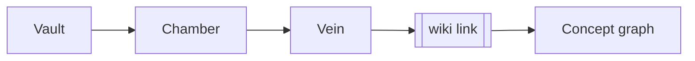

# Macusanite Wiki syntax

This file ships with the application, where it is available from **☰ → Vault Wiki.md**, and it is the reference for every markdown convention that the viewer understands. Because the file is ordinary markdown, reading it in the viewer also confirms that the renderer is working.

## 1. The shape of a vault

| Term | Meaning |
| --- | --- |
| **Vault** | A folder tree of markdown, plus a `.macusanite/` metadata folder at its root |
| **Chamber** | A folder inside the vault |
| **Vein** | A `.md` file inside a chamber (or at the vault root) |

```
My Vault/
├── .macusanite/            # metadata, settings, colours, history, logs
│   ├── vault.json          # name, description, created
│   ├── settings.json       # viewer + default colours (followed live)
│   ├── colors.json         # every page/section/link colour you picked (followed live)
│   ├── history.json        # undo and redo stacks
│   ├── index.json          # headings, links and tags per vein (a cache)
│   └── logs/               # session-YYYYMMDD.log (JSON lines)
├── Home.md
└── Chambers/
    ├── Fieldwork/
    │   └── Sampling Plan.md
    └── Lab/
        └── Analytical Methods.md
```

Folders whose names begin with `.` are never indexed, which keeps `.macusanite` and `.git` out of the tree and the graph. A vein may use the `.md`, `.markdown` or `.mdx` extension.

The viewer watches the folder while the vault is open, so a vein that another program creates, edits or deletes is reflected in the tree, the graph and the open page without a reload. The viewer never overwrites unsaved text in the editor. If another program saves the vein that is being edited, the warning offers a line-by-line merge of the two versions, showing the lines from disk, the lines from the draft and every real conflict for the reader to settle, and it also allows either version to be taken on its own.

The viewer follows `settings.json` and `colors.json` as well, because these are the two metadata files that users are expected to edit by hand. When a theme, font size, panel width or colour is written into either file, the open window applies the change immediately without writing anything back. The remaining files in the folder are the viewer's own bookkeeping, and the viewer leaves them alone.

### Opening a vault

Opening a vault begins with a single walk of the folder and then reads `.macusanite/index.json`, which records what each vein contained the last time it was read: its title, aliases, headings, links, tags and front-matter colours. If a vein's modification time and size still match the cache entry, the viewer takes its metadata from the cache, so a vault that has not changed opens without reading any vein at all. The viewer reads everything else afterwards in the background while the tree, the graph, wiki links and search are already usable. The sidebar footer reports progress such as `indexing 420/5001`, and it later reports how many veins are described.

Deleting `index.json` is safe, because the next open reads the vault and writes the file again. When a vein is edited outside the viewer, it is re-read as soon as the watcher notices the change, and when a vein is saved from the viewer, its own cache entry is refreshed immediately.

## 2. Wiki links

| Syntax | Result |
| --- | --- |
| `[[Cesium Enrichment]]` | link by vein name, resolved anywhere in the vault |
| `[[Chambers/Lab/Analytical Methods]]` | link by vault-relative path |
| `[[Analytical Methods\|the methods]]` | aliased link — the reader sees *the methods* |
| `[[Fluid Inclusions#Method]]` | link to a section of another vein |
| `[[#Field checklist]]` | link to a section of **this** vein |
| `![[Sampling Plan]]` | reference card (embed marker) for another vein |

### How a name finds its target

1. an explicit path (`Chambers/Lab/Methods`, with or without `.md`)
2. a vein in the **same chamber**
3. the shallowest vein with that name anywhere in the vault
4. a front-matter `title:` or `aliases:` match
5. a case-insensitive file-name match

If no target matches, the link appears as a **ghost**, which is drawn with a dotted underline and a `＋` badge. Clicking a ghost creates the vein at the suggested location inside the current chamber and then opens it.

### Heading anchors

Every ATX heading (`#`, `##`, …) receives a stable anchor id derived from its text:

| Heading | Anchor |
| --- | --- |
| `## Sieve series` | `sieve-series` |
| `### Th 780C — hot, dry!` | `th-780c-hot-dry` |
| `## Undo/redo` | `undoredo` |

The same rules run in Rust and JavaScript, so `[[Note#Th 780C — hot, dry!]]` resolves identically regardless of which side computes the anchor.

## 3. Colours

Every **page**, every **link** and every **section** can carry a colour. To assign one, click the small swatch beside a heading, beside a wiki link or in the document header. Each element begins at the vault default, which is **white** until it is changed in **Settings → Default colours**.

```text
page  ●  the swatch in the title row
link  ●  the swatch immediately before a [[wiki link]]
sect  ●  the swatch immediately before a heading
```

The viewer applies the following rules:

* a **section** without a colour of its own inherits its page colour;
* a **link** without a colour of its own inherits the colour of the page from which it starts;
* in the graph, an edge is drawn as a gradient that leaves the **source** in the link colour and arrives at the **target** in the target page's colour, fading across the line;
* front matter `color:` supplies a document's initial colour, and a colour chosen with the swatch overrides it, so a selection always has a visible effect:

```markdown
---
title: Cesium Enrichment
color: '#da70d6'
link-color: Violet
section-color: SlateBlue
---
```

The picker offers a common palette, a searchable selection of X11 colours, a `#hex` field and red, green and blue sliders that remain synchronized with one another.

## 4. Diagrams with mermaid

A block fenced with `mermaid` renders in place:



Flowcharts, sequence diagrams, class diagrams, state diagrams, pie charts, gantt charts and journey diagrams are all available, as is anything else that mermaid supports. If a diagram fails to parse, the page shows its error and source inline rather than failing.

## 5. Tags and concepts

A `#tag` written in prose, or a `tags:` front-matter list, becomes a **concept node** in the graph:

```markdown
tags: [petrology, geochemistry]
```

Tags connect pages that never link to each other directly, which is what allows a vault-wide view to remain useful.

## 6. Other markdown you will use

> [!TIP] Callouts
> Blockquotes that begin with `[!NOTE]`, `[!TIP]`, `[!IMPORTANT]`,
> `[!WARNING]` or `[!CAUTION]` are styled as callouts.

| Feature | Syntax |
| --- | --- |
| Tables | GFM pipe tables — the parser also understands alignment rows |
| Task list | `- [ ] todo`, `- [x] done` |
| Code | inline `` `code` `` and fenced blocks with a language tag |
| Footnote-style links | ordinary `[text](Chambers/Lab/Methods.md)` links open in the viewer too |

## 7. The concept graph

The right-hand pane answers two questions: what the current note contains and where that note sits within the vault.

| Node | Meaning |
| --- | --- |
| Large circle | the vein you are reading |
| Small ring | a section of that vein |
| Filled circle | another vein (linked, or linking here through context) |
| Dashed circle | a **ghost** — a page that does not exist yet |
| `#` circle | a tag |

The graph draws solid edges for wiki links, dotted edges for containment from a page to its sections, and faint edges for tags. The toggles at the bottom of the pane control depth, sections, tags, ghost pages and vault context. A node can be dragged to rearrange the graph, the background can be dragged to pan, the wheel zooms, and clicking a node navigates to it.

## 8. Searching

The sidebar provides two tabs: **Chambers**, which shows the vault tree, and **Search**. `Ctrl+F` opens Search and places the cursor in the box, and typing searches every vein in the vault as the query changes, covering titles, section headings, tags and body text in that order of rank. A vein whose title matches the query comes first, followed by veins that contain the query as a heading, while tags and body text follow; a match near the top of a vein also outranks the same word in a footnote.

| Query | Finds |
| --- | --- |
| `sieve series` | veins containing **both** words, anywhere, in any order |
| `"sieve series"` | only veins where the two words are adjacent |
| `Analytical Methods` | the vein of that name, first, whatever else matches |
| `#fieldwork` | the tag, wherever it appears |

Each result explains its match as a `title`, a `§ section`, a `tag` or a count of occurrences in the text, and it includes a snippet with the search terms already marked. Clicking a result opens the vein and marks every hit in the page while ringing the current one; `F3` and `Shift+F3` move through the hits, and the counter above the results reports the position. `Esc` clears the query, and a second `Esc` restores the tree.

Search reflects the current state of the vault, because the viewer watches the folder. A vein that another program adds or edits becomes searchable immediately, and text that has been typed into the editor but not yet saved is searchable as well.

Because a vault is indexed lazily, a search is answered in two stages while the query is being typed. Titles, sections and tags are ranked from `.macusanite/index.json` immediately, while body text is read behind the results and those results appear as the text arrives; the status row shows progress such as `reading 240/5001…`. A title match therefore appears before any file has been read.

## 9. Keyboard

| Keys | Action |
| --- | --- |
| `Ctrl+S` | save the open vein |
| `Ctrl+Z` / `Ctrl+Shift+Z` | undo / redo (file-level, vault-wide) |
| `Ctrl+K` | quick jump to a vein by name |
| `Ctrl+F` | search the whole vault |
| `F3` / `Shift+F3` | next / previous search hit in the open vein |
| `F1` | the **Help** window: the manual, in its own window, with its own search |
| `Alt+←` / `Alt+→` | back / forward through navigation history |
| `Esc` | clear the search, close the search pane, or leave edit mode |

### This file is the syntax guide; the Help window is the program manual

The two documents cover different subjects, and both can be open at the same time:

* **this wiki** ([Wiki.md](Wiki.md)) documents the vault format, including wiki links, aliases, section anchors, mermaid, tags, callouts, colours and undo semantics;
* the **Help** window, opened with `?` in the top bar, **☰ → Help and manual**, or `F1`, documents everything the program does, including the command-line interface and the MCP server that allow an AI agent to perform the same operations without a window. It displays the generated document [docs/Help.md](docs/Help.md), which is the same text that `macusanite docs` prints.

The Help window has no connection to a vault and requires none. It opens over whatever is being read, provides a search in which every typed word must appear and a `"a quoted phrase"` must appear whole, steps through the hits with `Enter`, and closes without modifying the vault.

## 10. What undo actually restores

Undo and redo are recorded as before-and-after snapshots of a single file, so they restore the file exactly. Edits to veins, new veins and chambers, colour assignments, settings changes and vault description changes are all undoable. Viewer state, such as which page was open and which chambers were expanded, is stored in `state.json` and is deliberately excluded from the undo stack.
