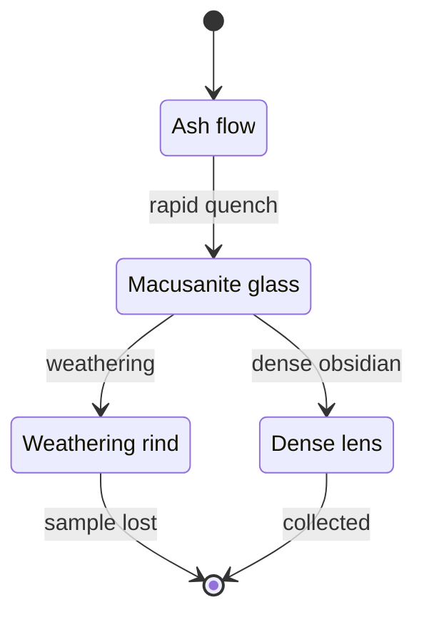

# Macusanite Occurrence

Macusanite is a caesium-rich volcanic glass found near **Macusani, Peru**, in
Pliocene ignimbrites.

## Setting

The glass occurs as dense obsidian-like lenses inside ash-flow tuff. See
[[Chambers/Mineralogy/Fluid Inclusions]] for what the bubbles tell us, and
[[Chambers/Fieldwork/Sampling Plan]] for how we collect it.

### Structural control

Lenses sit along a NE-trending fault system. Weathering rinds are thin, which
means the glass is unusually fresh for its age.

## Mineralogy

* [[Chambers/Mineralogy/Cesium Enrichment]]
* [[Chambers/Lab/Analytical Methods]]
* [[#Field checklist]] — a link to a section of this very note

## Formation

## Field checklist

1. Record GPS and lithology for every lens.
2. Wrap samples in foil before the rind dries out.
3. Log grain size on the [[Chambers/Lab/Analytical Methods#Sieve series|sieve series]].
