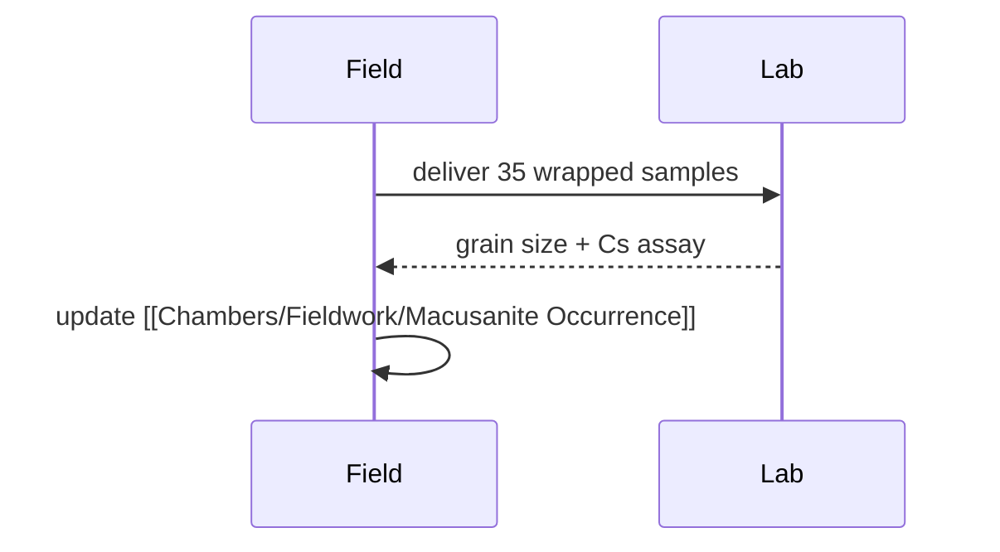

# Sampling Plan

## Objectives

Collect at least 12 fresh lenses per transect so that
[[Chambers/Lab/Analytical Methods]] has statistical weight.

## Transects

| Transect | Location | Target | Notes |
| --- | --- | --- | --- |
| T1 | North ridge | 12 lenses | fault-controlled |
| T2 | Dry wash | 8 lenses | reworked clasts |
| T3 | Plateau | 15 lenses | freshest glass |

## Sequence

## Risks

- Rind formation if samples stand wet overnight.
- Duplicate lenses: cross-check with [[Chambers/Mineralogy/Fluid Inclusions]].
