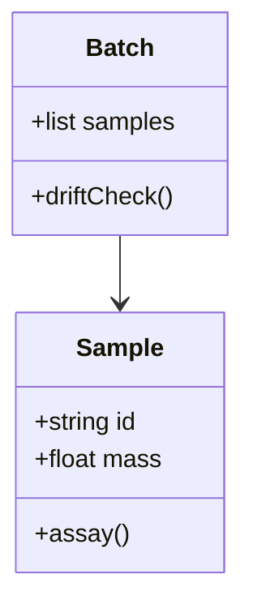

# Analytical Methods

## Sieve series

Standard half-phi sieves from 4 mm down to 32 µm.

## Calibration

Standards are re-measured every ten samples.

### Drift

Drift above 3 % invalidates the batch; the run is repeated. Related:
[[Chambers/Mineralogy/Fluid Inclusions#Method]].

## Instrument map

