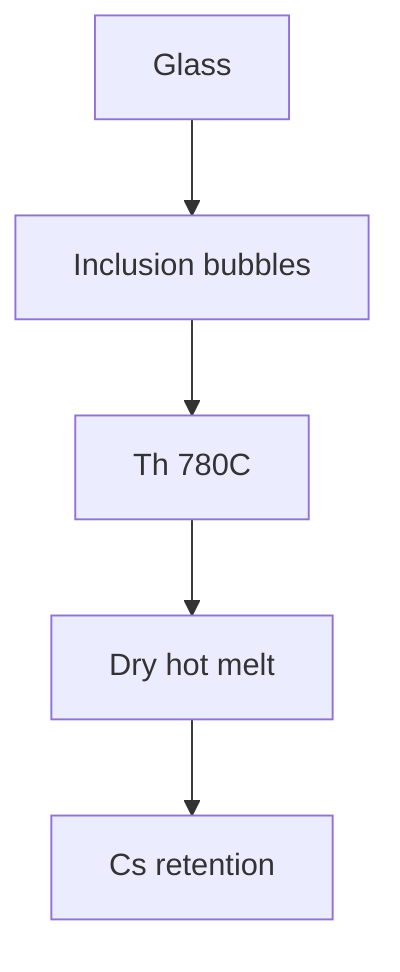

# Fluid Inclusions

Heating and freezing stages on doubly polished wafers.

## What they record

Homogenisation temperatures cluster near 780 °C, which suggests a very hot,
dry melt — consistent with the caesium budget in
[[Chambers/Mineralogy/Cesium Enrichment]].

## Method

1. Prepare 150 µm wafers.
2. Freeze to -180 °C, then heat at 5 °C/min.
3. Tabulate with [[Chambers/Lab/Analytical Methods#Calibration]].

## Interpretation

