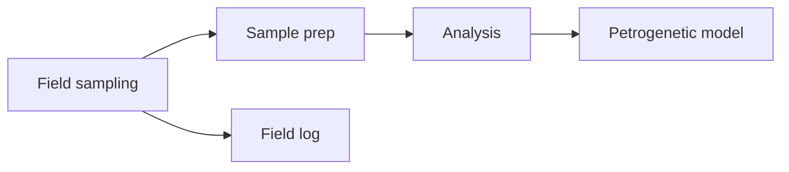

# Welcome to your vault

Macusanite reads a **vault**: a folder tree full of markdown. Folders are
*chambers*, and every `.md` file inside them is a *vein*.

> [!TIP] Everything below is a live document — click a link, then watch the graph
> on the right recolour and the breadcrumbs at the top fill in.

## The three panes

| Pane | What it does |
| --- | --- |
| Left | Vault tree — click a chamber to fold it open, click a vein to read it |
| Centre | The rendered vein, with colour swatches beside pages, links and sections |
| Right | Concept graph of this note and its context in the wider vault |

## Where to go next

* [[Chambers/Fieldwork/Macusanite Occurrence]] — where the glass is found
* [[Chambers/Mineralogy/Cesium Enrichment]] — why this rock matters
* [[Chambers/Lab/Analytical Methods]] — how we measure it
* [[Chambers/Fieldwork/Sampling Plan|the sampling plan]] — aliased links work too
* [[Glossary]] — not written yet, so this one is a ghost you can create

## Diagramming

Mermaid fences are rendered in place:

## Reference cards and hand-written links

A reference card points at another vein without leaving this one:
![[Chambers/Fieldwork/Sampling Plan]]

Ordinary markdown links work as well — [the sieve series](Chambers/Lab/Analytical%20Methods.md#Sieve%20series),
a hand-written one with spaces in the name, [analytical methods](Chambers/Lab/Analytical Methods.md), and web
links such as [mermaid docs](https://mermaid.js.org/) open in your browser instead of the vault window.

- [x] open a vault
- [ ] colour a section
- [ ] create a vein from a ghost link

## Colour, everywhere

Every page, every link and every section can carry a colour. Click the little
swatch next to a heading or a link and pick one — link colours fade along the
line in the graph towards the colour of their target.
