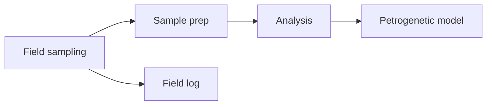
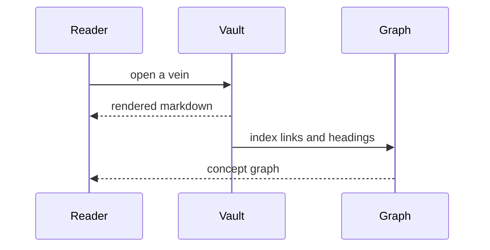

# Welcome to your vault

Macusanite reads a **vault**: a folder tree full of markdown. Folders are
*chambers*, and every `.md` file inside them is a *vein*.

> [!TIP] Everything below is a live document — click a link, then watch the graph
> on the right recolour and the breadcrumbs at the top fill in. Home is also a
> canvas (switch at the top right): its cards are this page's headings, and the
> labelled clusters demonstrate the canvas features; unrelated cards and groups
> are spaced apart, while nested groups are contained by design.

## The three panes

| Pane | What it does |
| --- | --- |
| Left | Vault tree — click a chamber to fold it open, click a vein to read it |
| Centre | The rendered vein, with colour swatches beside pages, links and sections |
| Right | Concept graph of this note and its context in the wider vault |

## Where to go next

* [[Chambers/Fieldwork/Macusanite Occurrence]] — where the glass is found
* [[Chambers/Mineralogy/Cesium Enrichment]] — why this rock matters
* [[Chambers/Lab/Analytical Methods]] — how we measure it
* [[Chambers/Fieldwork/Sampling Plan|the sampling plan]] — aliased links work too
* [[Glossary]] — not written yet, so this one is a ghost you can create

## Diagramming

Mermaid fences are rendered in place:

### Flowchart

A flowchart lays a process out left to right — the same shape the
progression board on this canvas borrows: earlier steps on the left,
later ones towards the right.

### Sequence diagram

A sequence diagram names the actors and the order they speak in, top to
bottom. Both diagram kinds render in place, exactly where they are written.

## Reference cards and hand-written links

A reference card points at another vein without leaving this one:
![[Chambers/Fieldwork/Sampling Plan]]

Ordinary markdown links work as well — [the sieve series](Chambers/Lab/Analytical%20Methods.md#Sieve%20series),
a hand-written one with spaces in the name, [analytical methods](Chambers/Lab/Analytical Methods.md), and web
links such as [mermaid docs](https://mermaid.js.org/) open in your browser instead of the vault window.

- [x] open a vault
- [ ] colour a section
- [ ] create a vein from a ghost link

## Colour, everywhere

Every page, every link and every section can carry a colour. Click the little
swatch next to a heading or a link and pick one — link colours fade along the
line in the graph towards the colour of their target.

## Try the Worldbuilding canvas

This page opens as a Worldbuilding canvas (the switch at the top right of the
centre pane). The canvas is a tour, not a pile: every feature has a labelled
cluster, and unrelated cards, group boxes, annotations and group tabs are
spaced so they do not cover one another. Nested groups are contained within
their parent group by design.

| Cluster | What to try |
| --- | --- |
| **Progression board** (amber, top) | Heading tiers become columns; drag the group tab or right-click it to split or collapse it |
| **Locked demo** (red) | Gold padlocks are clickable; one card is also node-locked, and the group is locked |
| **Frozen demo** (blue) | Blue snowflakes are **Static**: read-only and fixed; right-click and choose **Unfreeze** is the only exit |
| **Pinned demo** (green) | A pinned group and a pinned node; **Arrange** flows around both |
| **Nested groups** (teal, bottom right) | An outer group contains two child groups; drag a child tab to move its pair, or the outer tab to move the whole hierarchy |
| **Resized card** (inside Nested groups) | The field-notes card is 420 × 180; drag its bottom-right corner to resize it, or double-click that corner to reset it |
| **Annotations** (colour band above the groups) | Right-click a note to choose its colour, or click its chevron to fold it to the coloured header |
| **Card modes** (purple, right) | Full, compact, thumbnail and folded cards, with an image on the thumbnail |
| **Collapsed group** (right, below modes) | One summary card replaces two cards; double-click it to expand |
| **Thin group + orphan card** (bottom left) | Deliberate health warnings: ⚠ lists the one-card group and the unconnected card beside it |

* **Overview** folds every card, then fits the whole graph to the screen — a
  bird's-eye table of contents. **Fit**, **Fit selection** and
  **Centre** find far-apart cards without panning.
* Cards snap to guides while dragging; a Ctrl+click selection drags as a unit,
  then **Align** and **Distribute** tidy the set.
* Drag one free card over another to see the dashed **overlap** warning; use
  **Push aside** while dragging, or **Resolve overlaps** in the inspector.
* Connectors run as **elbow** wires with **arrowheads**, and the notes above
  the groups are free-floating **annotations** in several colours. Click a
  note's chevron to fold it, or right-click it to change its colour. The health
  panel (⚠ in the toolbar) lists orphans and thin groups.
* The **Progression board** group is split into Kanban-style columns by
  heading tier: the top card on the left, its subsections one tier to the
  right, and their own subsections to the right of those. Right-click a
  group to split it, or use **Arrange → Progression**.
* Canvas undo steps are **named** — use the history browser beside the undo
  button to jump between them, and the file-history log to see the vault's
  whole story.

## Freeze and Static

This card sits in the blue **Frozen demo** group. **Freeze** turns a card or a
group **Static**: it stays read-only and fixed in place, and wears a blue
snowflake instead of the gold padlock. A Static item is deliberately not
unlocked by its badge.

## Unfreeze from the menu

Clicking a blue snowflake explains the state; it never clears it. Right-click
the frozen card or group and choose **Unfreeze** — for a card inside a frozen
group, the command is under **Group**. The same menu is the only way out of
Static.

## Card display modes

This is a **Full** card. The **Card modes** group beside it also holds
**Compact**, **Thumbnail** and **Folded** cards. Right-click any card and use
**Card mode**, or choose **Cards ▾** in the toolbar to apply a mode to a whole
selection.

### Compact card

Compact keeps the type, title, link count and word count, then drops the prose
so a dense overview stays readable. This card is compact.

### Thumbnail card

Thumbnail is the node's image — or its initial when it has none — at 128 × 128.
This card uses the sample's node image.

### Folded card

The chevron in a card's head folds it to its header. Folded cards stack neatly
above the card they link to; **Overview** folds the whole canvas at once.

## Collapsible groups

**Collapse to summary** replaces a group's cards with one summary card showing
its name, icon, member count, types and link total. The **Collapsed group**
below starts collapsed; double-click its summary, or choose **Expand group**,
to bring the cards back.

## Collapsed group summary

This card is hidden behind the summary until the group expands. That is the
point: collapse is a view, and the markdown remains exactly as written.

## Health and orphans

This one-card group is deliberately thin. **Health** (⚠ in the toolbar) lists
thin groups and orphans so an unfinished corner is easy to find. This card is
also fitted to its content, showing the whole note without an inner scrollbar;
right-click it and choose **Card height → Fit to content** to do the same to
another full card.

## Nested groups

The **Nested groups** demo is one outer group containing two child groups.
Dragging a child tab moves that child's pair, while dragging the outer tab
moves the direct card and both child groups together.

### Nested group: field notes

This card is **resized** to 420 × 180 canvas pixels. Drag its bottom-right
corner to change that box, and double-click the corner to restore the designed
size.

### Nested group: lab notes

The outer group's tab sits above both child tabs, so the hierarchy is visible
without hiding either child group's own controls.

### Nested group: samples

A child group can hold its own cards while its parent holds another card and
the child group. This cluster shows that arrangement.

### Nested group: results

Select the outer group to move the whole hierarchy, or select either child to
move only that child's cards.

# Orphan card

This card has no group and no wires. Health lists it as an **orphan**, beside
the thin group next door; click either row to select and centre it.

For the full tour, see [[Chambers/Vault Notes#Worldbuilding canvas tour]].
